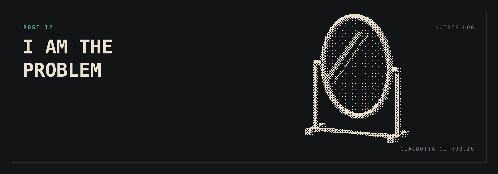

# Post 12 / I am the problem

Months ago I started translating the website into other languages. The pages
brought results, so I went back to it. The plan: five more languages, 30 new
pages. Last time Claude struggled with Squarespace, and I closed the job myself
with copy and paste. This time I changed one thing: how I asked.

**WHAT I CHANGED**

- Last time I gave it a task: translate the pages.
- This time I gave it a goal: 30 pages live in five new languages.
- And one instruction: get around every obstacle on the way.

**WHAT HAPPENED**

- The old problems disappeared. Writing inside text blocks. Working with Squarespace elements built for humans.
- It published every page live.
- My correction was minimal. The manual part from last time is gone.

**LEARNINGS**

- I could have done this two or three months ago. I waited because a small manual step was left.
- The tool was not the limit. The goal I gave it was.
- I spend my time fixing small problems it now solves alone. That time should go into learning how to use it.

If I invest too little time in learning, I am the problem.
