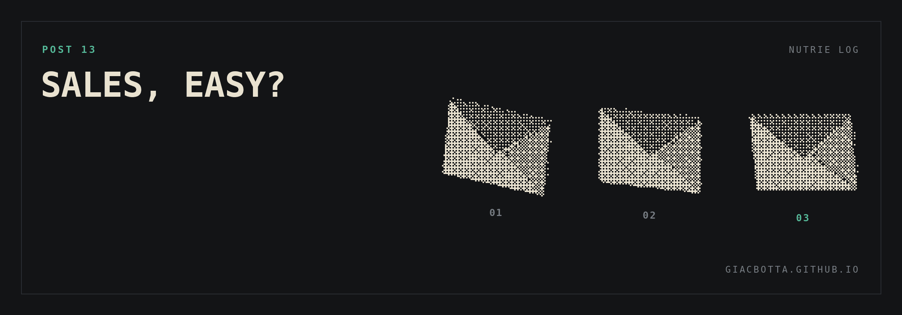

# Post 13 / Sales, easy?

One of the tasks Claude made simplest is selling. More precisely: reaching the
right person or business, fast and directly. My need is simple: I want every
small hotel and B&B near my sites to know the business and promote it. In
exchange they get a coupon code: a discount for them or for their guests.

**BEFORE**

- When I started with luggage storage in Venice, building this list took a long series of web searches.
- Since a mailing tool was not worth it for my needs, also some manual work after.

**NOW**

- Claude built the list in 2 minutes.
- It also automated a sequence of 3 emails, sent at set intervals, to explain the offer.
- Setting up the whole thing took me one hour.
- Many replied to the second or third email, not the first.
- The list held up. At least 10 B&Bs now promote me, each with its own coupon code.

**THE QUESTION**

- Finding the right contact used to cost time. That cost filtered who got contacted.
- Now it costs almost nothing. For me, and for every other business.
- The same B&Bs can now receive the same three emails from anyone.

Will easy access to the right contact make sales connections easier, or only make spam endless?
